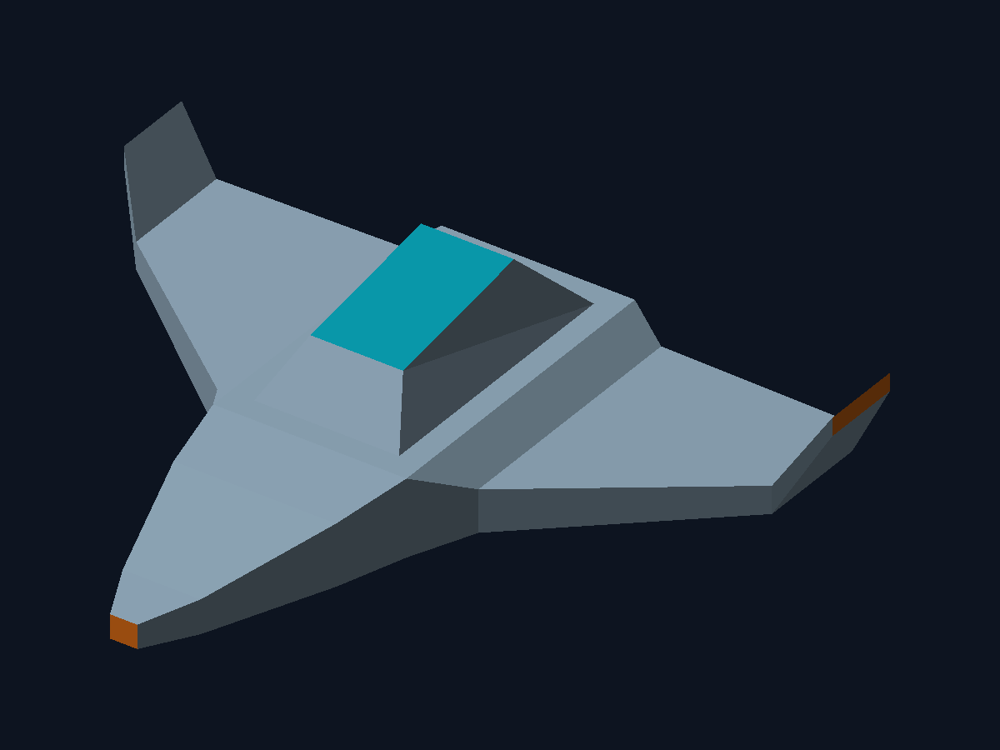

# Lab 4 — Carga de modelos OBJ en Rust

Carga la nave **Quetzal 01** del Lab 3 y dibuja sus caras con un rasterizador
propio en CPU. La geometría se centra y se ajusta automáticamente a una ventana
de 1200 × 900, conservando márgenes y proporciones.



## Ejecutar

Requisitos: Rust y Cargo, CMake y compilador C para construir Raylib. En macOS,
las Command Line Tools de Xcode proporcionan el compilador y las bibliotecas del sistema.

Desde esta carpeta:

```sh
cargo run --release
```

- Flechas izquierda/derecha: rotar la vista.
- `R`: volver a la vista inicial.
- `S`: guardar el framebuffer en `entrega/modelo_renderizado.png`.
- `Esc`: cerrar.

Exportar la imagen sin abrir una ventana:

```sh
cargo run --release -- --render entrega/modelo_renderizado.png
```

Cargar otro OBJ triangulado:

```sh
cargo run --release -- --model ruta/modelo.obj
```

El archivo `.mtl`, si el OBJ lo referencia, debe estar junto al modelo.

## Cómo funciona

1. `obj.rs` lee las posiciones `v`, las caras `f` y los colores base `Kd` del MTL.
   Acepta índices OBJ positivos, negativos y variantes `v/vt/vn` o `v//vn`.
   Rechaza índices inválidos, geometría vacía y caras sin triangular.
2. `render.rs` transforma los vértices a una cámara ortográfica y los ajusta al
   centro del framebuffer. Recorre manualmente todas las caras, obtiene los tres
   vértices por sus índices y llama a `Framebuffer::triangle`.
3. `framebuffer.rs` recorre la caja delimitadora de cada triángulo, calcula
   coordenadas baricéntricas e interpola la profundidad de cada píxel. Un z-buffer
   resuelve las superficies ocultas. Los dos órdenes de vértices son válidos.
4. La iluminación plana aplica un factor ambiental y difuso al color de cada cara.
5. Raylib muestra la textura del framebuffer. No se usan sus primitivas para
   dibujar triángulos o modelos 3D. `image` guarda el mismo framebuffer como PNG.

La función de triángulos se creó para este laboratorio, porque no se encontró una
implementación previa en los proyectos de esta carpeta.

## Verificación

```sh
cargo test
cargo clippy --all-targets -- -D warnings
```

Las pruebas cubren índices OBJ, rechazo de datos inválidos, profundidad
independiente del orden de dibujo, orientación inversa y triángulos degenerados
u ocultos fuera de pantalla.

## Entrega

Publicar esta carpeta en un repositorio Git e ingresar su URL en la plataforma.
La imagen ya está incluida arriba y en `entrega/`. No incluir `target/`.
